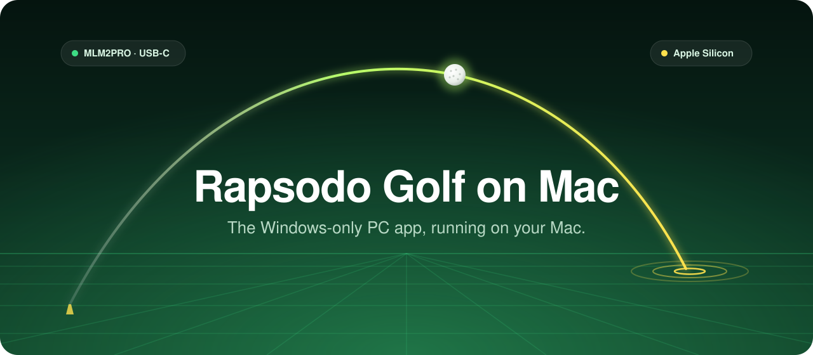

<div align="center">



**[Install](#install)** · **[Play](#play)** · **[Troubleshooting](#troubleshooting)** · **[How it works](#how-it-works)**


<a href="https://www.buymeacoffee.com/aerstrike"></a>

</div>

## Your MLM2PRO, your Mac, no Windows PC.

Rapsodo only ships **Rapsodo Golf for PC** for Windows. This project runs it on an
Apple Silicon Mac under Wine, fixes the parts that break, and gives you a normal
Mac app to open. Plug the monitor in over USB-C and play.

<div align="center">

| | Step | What happens |
|:---:|---|---|
| **01** | Install | One script sets up Wine, Rapsodo's app and the fixes. |
| **02** | Plug in | MLM2PRO on USB-C, powered on. |
| **03** | Play | Open **Rapsodo Golf (Mac Port)**, sign in, hit balls. |

</div>

### Status

| | |
|---|---|
| ✅ **Works** | App opens, finds the monitor, signs in, runs firmware updates (tested 4.1.9 → 4.1.19). Driving Range opens, connects and arms the monitor. |
| 🟡 **Not confirmed yet** | Shot capture over a full session (the monitor dropped out twice in testing), alignment, camera view. |
| 🖥️ **Tested on** | macOS 26.6 and 27.0.1, M4 Mac, Rapsodo Golf 1.0.0 |

> [!NOTE]
> **Unofficial.** This is a community project, not made or endorsed by Rapsodo.
> It contains scripts and patches only, no Rapsodo files: you download the app from
> Rapsodo yourself, and the patches are applied to your own copy. A Rapsodo update
> can break it at any time. Use at your own risk.

## What you need

- A Mac with Apple Silicon (M1 or later).
- An MLM2PRO and a USB-C cable.
- A Rapsodo account with a membership that includes the PC app. Rapsodo says the
  PC app needs a Core membership ([Rapsodo Golf for PC](https://rapsodo.com/pages/rapsodo-studios-for-pc)).
- About 3 GB of disk space, plus 2–5 GB for each game you download from inside the
  app (Driving Range is about 4 GB).
- Your Mac password (or Touch ID) each time you play. See [Skip the password](#skip-the-password).

## Install

Every command below goes in the **Terminal** app (Applications → Utilities →
Terminal). Paste one block, press Return, and wait for it to finish before the next.

1. **Install Homebrew**, the Mac package manager. It also installs Apple's
   command-line developer tools. Follow its prompts.

   ```bash
   /bin/bash -c "$(curl -fsSL https://raw.githubusercontent.com/Homebrew/install/HEAD/install.sh)"
   ```

   When it finishes it prints two or three "Next steps" commands. Run them, then
   close and reopen Terminal.

2. **Install the build tools and iTerm.** The app is started from
   [iTerm](https://iterm2.com/) (see [Why iTerm](#why-iterm)).

   ```bash
   brew install mingw-w64 cmake libusb && brew install --cask iterm2
   ```

3. **Install Rosetta 2.** Wine is an Intel program.

   ```bash
   softwareupdate --install-rosetta --agree-to-license
   ```

4. **Download this project.** Keep the folder where it is: the Mac app runs the
   scripts in it.

   ```bash
   git clone https://github.com/wtabor/rapsodo-golf-mac.git ~/rapsodo-golf-mac
   ```

5. **Download the Rapsodo app.** On
   [Rapsodo's PC app page](https://rapsodo.com/pages/rapsodo-studios-for-pc), click
   **Download PC App**. You get `RapsodoGolfSetup.zip` (about 240 MB) in Downloads.
   Don't unzip it.

6. **Run the installer.** It downloads Wine and the other pieces, installs
   Rapsodo's app, applies the fixes and creates **Rapsodo Golf (Mac Port)** in
   Applications.

   ```bash
   ~/rapsodo-golf-mac/scripts/install.sh ~/Downloads/RapsodoGolfSetup.zip
   ```

## Play

1. Plug the MLM2PRO into the Mac with USB-C and turn it on.
2. Open **Rapsodo Golf (Mac Port)** from Applications (drag it to the Dock to keep it
   handy). It opens an iTerm window that starts everything.
3. Type your Mac password when iTerm asks. The Rapsodo app opens once the monitor
   is connected; sign in with your Rapsodo account.

**First launch only**, macOS asks for two permissions. Allow both:

- **Let `bash` control iTerm** (Automation). If you miss it, the app says
  "Could not open iTerm": turn on iTerm under **bash** in System Settings →
  Privacy & Security → Automation, then open the app again.
- **Let iTerm find devices on your local network.** If you never see this prompt
  or missed it, make sure iTerm is on in System Settings → Privacy & Security →
  Local Network. Without it the Rapsodo app can't find the monitor.

**Your location (games only).** The games ask for a location and won't play without
one; this project answers for them with a fixed position. Set yours once:

```bash
cp ~/rapsodo-golf-mac/scripts/env.local.sh.example ~/rapsodo-golf-mac/scripts/env.local.sh
open -e ~/rapsodo-golf-mac/scripts/env.local.sh
```

Put in your latitude, longitude and altitude (meters) and save. Without it the
games use 0/0. Also set the game's own **Elevation** (Settings → Required): that one
drives ball flight.

## Troubleshooting

| You see | Do this |
|---|---|
| iTerm says **Rosetta 2 is not installed** (common after a macOS update) | Run `softwareupdate --install-rosetta --agree-to-license`, then open the app again. Allow the iTerm prompt again if it comes back. |
| **Could not open iTerm** | System Settings → Privacy & Security → Automation → turn on iTerm under **bash**. Open the app again. |
| iTerm sits at **Waiting for the monitor** | The monitor turns itself off when idle: press its power button. After a replug it can take about 60 seconds to answer. |
| The Rapsodo app says **Device not found** | Wait a minute and retry. Check `~/Library/Logs/RapsodoGolf-usblink.log` for `feth0 DHCP (re)requested`. |
| A game says **Failed to initialize player / DirectX 11** | Run `~/rapsodo-golf-mac/scripts/45-install-dxvk.sh`, then start the game again. |
| Something broke after Rapsodo updated itself | Open the app again: it re-applies every fix on each launch. To do it by hand: `~/rapsodo-golf-mac/scripts/40-apply-patches.sh` then `~/rapsodo-golf-mac/scripts/45-install-dxvk.sh`. |
| The first sign-in times out | Nothing to do: the app retries on its own and the retry works. |

Game music can only be turned off inside each game's own settings.

## Skip the password

The USB link needs administrator rights each session, because macOS has no driver
for the MLM2PRO's USB network connection and the replacement
([TetherKit](https://github.com/XiaoMiku01/TetherKit)) must run as root. Pick one:

| Option | Each session | What runs as root |
|---|---|---|
| **Password** (default) | type your Mac password | TetherKit, only while you play |
| **Touch ID** (recommended) | touch the sensor | same as Password |
| **Always on** | nothing | TetherKit, all the time from boot |

**Touch ID** uses Apple's `sudo_local` hook ([macOS 14 Sonoma and
later](https://sixcolors.com/post/2023/08/in-macos-sonoma-touch-id-for-sudo-can-survive-updates/)).
It survives macOS updates and applies to every `sudo` on your Mac, not only this
project:

```bash
sudo sed 's/^#auth/auth/' /etc/pam.d/sudo_local.template | sudo tee /etc/pam.d/sudo_local
```

Check it with `sudo -v` in a new Terminal tab: you should get a Touch ID prompt.
Undo with `sudo rm /etc/pam.d/sudo_local`. It falls back to the password when Touch
ID isn't available (lid closed, external keyboard without Touch ID).

**Always on** installs TetherKit as a LaunchDaemon. No prompt at all, but a small
third-party USB driver then runs as root all the time, which is more attack surface
(for example a malicious USB device posing as the monitor). It runs root-owned
copies in `/usr/local/libexec/rapsodo-golf-mac/` and logs to
`/Library/Logs/RapsodoGolf-usblink.log`.

```bash
sudo ~/rapsodo-golf-mac/scripts/60-install-usb-daemon.sh              # install
sudo ~/rapsodo-golf-mac/scripts/60-install-usb-daemon.sh --uninstall  # remove
```

## Why iTerm

The Rapsodo app finds the monitor over mDNS, and macOS's Local Network privacy
only allows that for apps the user has approved. Wine's programs are unsigned, so
macOS never asks and silently blocks them. Started from iTerm, the app inherits
iTerm's permission. That's why the Mac app hands off to iTerm instead of starting
Wine itself.

## How it works

For developers. The full investigation, including dead ends, is in
[notes/2026-10-19-rapsodo-golf-pc-app-on-mac.md](notes/2026-10-19-rapsodo-golf-pc-app-on-mac.md);
`docs/architecture.html` is a diagram you can open in a browser after cloning.

| Layer | Piece |
|---|---|
| Windows runtime | [Gcenx wine-staging 11.16](https://github.com/Gcenx/macOS_Wine_builds/releases/tag/11.16) (unsigned build) |
| USB-C link | The MLM2PRO is a USB **RNDIS** network gadget (`2207:0019`). macOS has no RNDIS driver, so [TetherKit](https://github.com/XiaoMiku01/TetherKit) (userspace, no kext) bridges it. The monitor runs DHCP: it's `192.168.36.1`, the Mac gets `192.168.36.x`. |
| Fix 1 | Rebuilt `libzmq.dll` (4.3.5) without the 1 MB loopback "slow start" send that deadlocks under Wine → [`patches/`](patches/libzmq-4.3.5-no-fdpair-slowstart.patch) |
| Fix 2 | 1-byte patch in `deviceManagerServer.exe`: Go's `SIO_UDP_NETRESET` (unimplemented in Wine) → `SIO_UDP_CONNRESET`, so the CoAP certificate request and authentication work → [`scripts/patch_devicemanager.py`](scripts/patch_devicemanager.py) |
| Fix 3 | Unity games (Driving Range etc.) need D3D11; Wine's wined3d can't create the device on macOS. [DXVK-macOS](https://github.com/Gcenx/DXVK-macOS) (D3D11 → Vulkan → MoltenVK) is enabled per game exe → [`scripts/45-install-dxvk.sh`](scripts/45-install-dxvk.sh) |
| Fix 4 | Games ask WinRT `Geolocator` for a location, which Wine never grants. A stub `GeolocationPlugin.dll` reports `RGM_GEO_LAT` / `RGM_GEO_LON` / `RGM_GEO_ALT` → [`scripts/geolocation_stub.c`](scripts/geolocation_stub.c) |
| UI | Electron runs with `--no-sandbox --disable-gpu --disable-gpu-compositing --in-process-gpu` |

Each game ships its own `libzmq.dll`, `deviceManagerServer.dll` and
`GeolocationPlugin.dll`, so [`scripts/40-apply-patches.sh`](scripts/40-apply-patches.sh)
patches those too. [`scripts/play.sh`](scripts/play.sh) re-runs it and
`45-install-dxvk.sh` on every launch (about 4 seconds), because Rapsodo updates
and new game downloads undo them.

### Built on

<div align="center">

| [Wine](https://github.com/Gcenx/macOS_Wine_builds) | [DXVK-macOS](https://github.com/Gcenx/DXVK-macOS) | [TetherKit](https://github.com/XiaoMiku01/TetherKit) | [libzmq](https://github.com/zeromq/libzmq) |
|:---:|:---:|:---:|:---:|
| runs the Windows app | D3D11 for the games | USB-C network link | patched to stop a Wine deadlock |

</div>

## Open source

- **No Rapsodo files in this repo.** `.gitignore` blocks `*.exe`, `*.dll`, `*.zip`;
  patched DLLs and the app icon are produced on your Mac at install time.
- **Third-party pieces** are downloaded or built from their own projects, under
  their own licenses: [Gcenx's Wine builds](https://github.com/Gcenx/macOS_Wine_builds),
  [TetherKit](https://github.com/XiaoMiku01/TetherKit),
  [DXVK-macOS](https://github.com/Gcenx/DXVK-macOS) and
  [libzmq](https://github.com/zeromq/libzmq) (rebuilt with the patch in `patches/`).
- **Your location** stays in the gitignored `scripts/env.local.sh`, never in `env.sh`.
- **License:** not chosen yet.

<div align="center">

**Saved you from buying a Windows PC?**

<a href="https://www.buymeacoffee.com/aerstrike"></a>

</div>
